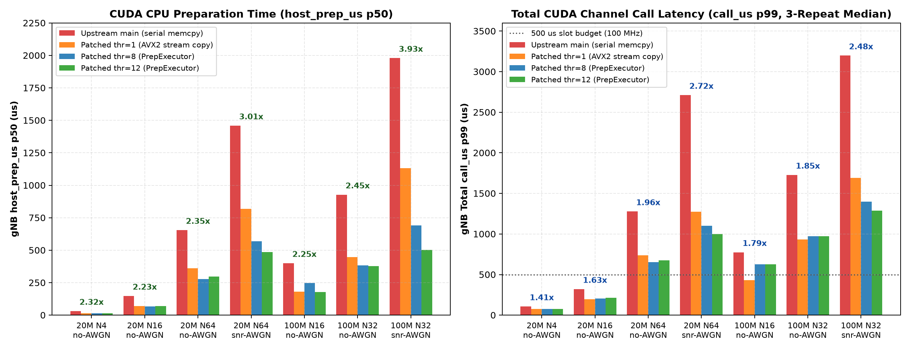

# Multithreaded CUDA host preparation on RTX 5090, 24 November 2026

On discrete GPUs (`cuda_host_memory: copy`, the `auto` default on RTX 5090), CPU host preparation (`host_prep_us`: packing incoming IQ into pinned `host_source_iq` and computing per-edge `snr_db` AWGN power) accounted for **54–82%** of total CUDA channel call latency at high fan-in or 100 MHz bandwidth. Combining write-only non-temporal streaming stores (`copy_to_pinned`) with an opt-in lock-free, caller-participating worker pool (`runtime.cuda_prep_threads`) cuts `host_prep_us` by **2.2–3.9×** and total gNB `call_us` p99 by up to **2.72×** while preserving **bit-exact** IQ output.

## RTX 5090 scaling (3-repeat medians)

Each patched row reports the median of three 5-second runs (ascending, descending, ascending) after a separate 2-second warmup on `gnb0` (`node:gnb0:*`), in explicit copy mode (`cuda_host_memory: copy`), 4-tap TDL + path loss + CFO (with or without per-edge `snr_db: 25` AWGN). Upstream baseline values were measured on the same machine at `upstream/main` (`c3753c0`).

| Workload (`OCG_BENCH_THREADS`) | Variant (`cuda_prep_threads`) | gNB `prep_p50` (µs) | gNB `call_p50` (µs) | gNB `call_p99` (µs) | `call_p99` range (µs) | `h2d_p50` (µs) | `prep` speedup vs `c3753c0` | `call_p99` speedup vs `c3753c0` |
|---|---|---:|---:|---:|---|---:|---:|---:|
| `20M_N4_noawgn` (`T0`) | upstream `c3753c0` | 30.8 | 92.5 | 106.3 | — | 27.7 | 1.00× | 1.00× |
| `20M_N4_noawgn` (`T0`) | patched `thr=1` | 13.3 | 72.4 | 75.2 | 74.6–75.6 | 22.0 | 2.32× | 1.41× |
| `20M_N4_noawgn` (`T0`) | patched `thr=12` | 13.3 | 72.4 | 75.2 | 75.0–75.7 | 21.9 | 2.32× | 1.41× |
| `20M_N16_noawgn` (`T0`) | upstream `c3753c0` | 147.2 | 272.7 | 320.1 | — | 75.0 | 1.00× | 1.00× |
| `20M_N16_noawgn` (`T0`) | patched `thr=1` | 70.9 | 181.3 | 196.4 | 195.6–202.6 | 61.0 | 2.08× | 1.63× |
| `20M_N16_noawgn` (`T0`) | patched `thr=8` | 66.0 | 177.3 | 202.9 | 202.7–209.9 | 60.7 | 2.23× | 1.58× |
| `20M_N64_noawgn` (`T0`) | upstream `c3753c0` | 654.1 | 979.6 | 1277.0 | — | 226.2 | 1.00× | 1.00× |
| `20M_N64_noawgn` (`T0`) | patched `thr=1` | 362.3 | 684.2 | 738.9 | 725.9–741.5 | 222.7 | 1.81× | 1.73× |
| `20M_N64_noawgn` (`T0`) | patched `thr=8` | 278.5 | 600.3 | 651.7 | 650.5–660.8 | 222.4 | **2.35×** | **1.96×** |
| `20M_N64_awgn` (`T0`) | upstream `c3753c0` | 1458.6 | 1812.9 | 2711.5 | — | 229.3 | 1.00× | 1.00× |
| `20M_N64_awgn` (`T0`) | patched `thr=1` | 819.8 | 1163.9 | 1273.4 | 1233.5–1274.9 | 222.5 | 1.78× | 2.13× |
| `20M_N64_awgn` (`T0`) | patched `thr=8` | 570.0 | 904.5 | 1103.4 | 975.3–1150.7 | 222.3 | 2.56× | 2.46× |
| `20M_N64_awgn` (`T0`) | patched `thr=12` | 484.8 | 820.0 | 997.7 | 973.4–1035.7 | 222.8 | **3.01×** | **2.72×** |
| `100M_N16_noawgn` (`T0`) | upstream `c3753c0` | 399.4 | 643.3 | 774.7 | — | 161.5 | 1.00× | 1.00× |
| `100M_N16_noawgn` (`T0`) | patched `thr=1` | 181.8 | 418.9 | 432.5 | 431.2–492.6 | 148.0 | **2.20×** | **1.79×** |
| `100M_N16_noawgn` (`T0`) | patched `thr=12` | 177.7 | 414.3 | 628.1 | 524.6–628.8 | 148.3 | 2.25× | 1.23× |
| `100M_N32_noawgn` (`T0`) | upstream `c3753c0` | 927.0 | 1347.2 | 1727.8 | — | 299.4 | 1.00× | 1.00× |
| `100M_N32_noawgn` (`T0`) | patched `thr=1` | 446.5 | 846.5 | 931.9 | 907.4–940.9 | 287.6 | 2.08× | **1.85×** |
| `100M_N32_noawgn` (`T0`) | patched `thr=12` | 378.2 | 781.7 | 971.4 | 949.5–980.6 | 287.9 | **2.45×** | 1.78× |
| `100M_N32_awgn` (`T0`) | upstream `c3753c0` | 1979.2 | 2413.7 | 3197.8 | — | 305.2 | 1.00× | 1.00× |
| `100M_N32_awgn` (`T0`) | patched `thr=1` | 1131.7 | 1552.1 | 1691.3 | 1685.4–1698.5 | 288.0 | 1.75× | 1.89× |
| `100M_N32_awgn` (`T0`) | patched `thr=8` | 690.4 | 1114.3 | 1400.1 | 1388.7–1556.1 | 289.3 | 2.87× | 2.28× |
| `100M_N32_awgn` (`T0`) | patched `thr=12` | 503.4 | 917.8 | 1289.3 | 1274.1–1336.8 | 288.9 | **3.93×** | **2.48×** |
| `20M_N64_awgn` (`T1`, concurrent) | patched `thr=1` | 18.8 (p99 1684.2) | 80.6 | 2052.0 | 1446.9–2215.6 | 14.8 | — | — |
| `20M_N64_awgn` (`T1`, concurrent) | patched `thr=8` | 18.0 (p99 450.7) | 77.2 | 808.7 | 806.5–824.1 | 13.6 | — | **2.54×** vs `thr=1` |
| `20M_N64_awgn` (`T1`, concurrent) | patched `thr=12` | 16.6 (p99 420.2) | 68.4 | 783.2 | 774.7–790.6 | 10.9 | — | **2.62×** vs `thr=1` |

Key findings:

- **Why non-temporal streaming stores matter on discrete GPUs**: Plain multi-threaded `memcpy` into pinned `host_source_iq` left 15.7 MB of dirty lines across many private L2 caches, forcing PCIe Gen 5 H2D DMA to snoop every core and degrading `h2d_us` from `298 → 584 µs` at 16 threads. Non-temporal AVX2 streaming stores (`_mm256_stream_si256` + `_mm_sfence`) both halve DRAM write traffic (eliminating RFO reads) and keep `h2d_us` flat at `288–289 µs` across all thread counts.
- **When `cuda_prep_threads > 1` wins most**: Workloads with large fan-in (`N=64`) or CPU-side per-source `snr_db` AWGN power scans (`20M_N64_awgn`, `100M_N32_awgn`, concurrent `T1`) improve `prep` by **2.0–4.0×** beyond `thr=1` and **3.0–3.9×** vs `upstream/main`. Under concurrent per-node threads (`20M_N64_awgn_T1`), gNB `call_p99` drops from `2052.0 → 783.2 µs` (**2.62×**).
- **Honest p99 caveat on medium copy-only payloads**: On `100M_N16_noawgn` (7.86 MB pure copy), `thr=1` with streaming copy already cuts `call_p99` from `774.7 → 432.5 µs` (inside the 500 µs slot budget), whereas `thr=8/12` adds hybrid P/E-core wakeup tail variance (`624–628 µs` p99). On `20M_N4_noawgn` (below the 1.5 MiB parallel copy threshold), `thr=1/8/12` stay identical (`72.4 µs` p50, `75.2 µs` p99) with zero regression.

## Live two-cell OCUDU gNB + srsUE interop

Two containerized OCUDU gNBs (`PCI=1`, `PCI=2`, 20 MHz FDD band n3, 23.04 MS/s, 1×1), two srsUE containers (`10.45.1.2`, `10.45.1.3`), and Open5GS 5GC ran through the native CUDA broker on `topology.multi-gnb.cuda.yaml` (which carries `snr_db: 25` AWGN on `serving` edges) for 40 seconds per setting:

| `cuda_prep_threads` | Cells up / RF overflow | UE0 & UE1 attach / PDU / ping | Broker `tx_queue_overflows` / `tx_sequence_gaps` / `zmq_errors` | `rx_starvations` | Broker `call_us` p50 (`gnb0`/`gnb1`/`ue0`/`ue1`) | Broker `call_us` p99 (`gnb0`/`gnb1`/`ue0`/`ue1`) |
|---:|---|---|---|---:|---|---|
| 1 | 2/2, 0 ovf | 2/2 RRC + PDU + 100% ping | 0 / 0 / 0 | 6 | 90 / 90 / 90 / 90 µs | 140 / 145 / 165 / 165 µs |
| 8 | 2/2, 0 ovf | 2/2 RRC + PDU + 100% ping | 0 / 0 / 0 | 2 | 70 / 75 / 90 / 90 µs | 115 / 110 / 135 / 145 µs |

Both runs passed full attach, PDU session, and ICMP traffic with zero RF overflows or transport errors; `cuda_prep_threads: 8` lowered live gNB p50 latency 17–22% and p99 latency 18–24%. Strict zero-starvation real-time qualification is not claimed.

## Setup, correctness, and reproduction

- **Hardware and toolchain**: NVIDIA GeForce RTX 5090 (driver 595.71.05, PCIe Gen 5 ×16 max), Intel Core Ultra 9 285K (8 P-cores + 16 E-cores), CUDA 13.0 (`V13.0.88`), GCC 13.3.0, Release `sm_120` build, based on `upstream/main` (`c3753c0`).
- **Correctness**: CPU and CUDA CTest suites pass **14/14** each (including `cuda_prep_parallel`, verifying `PrepExecutor` barrier/exception/8-caller stress and **bit-exact** `memcmp` CUDA IQ parity between `cuda_prep_threads: 1` and `8` across device-channel, `snr_db` AWGN, explicit `rx_model` AWGN, legacy host-staging fallback, 4×4 MIMO sub-source chunking + parallel `host_out`, and concurrent 4-RX-node GPU calls); `compute-sanitizer --error-exitcode=1` reports **0 errors**.
- **Raw dataset**: `formal_cuda_prep_results.csv` accompanies this report.
