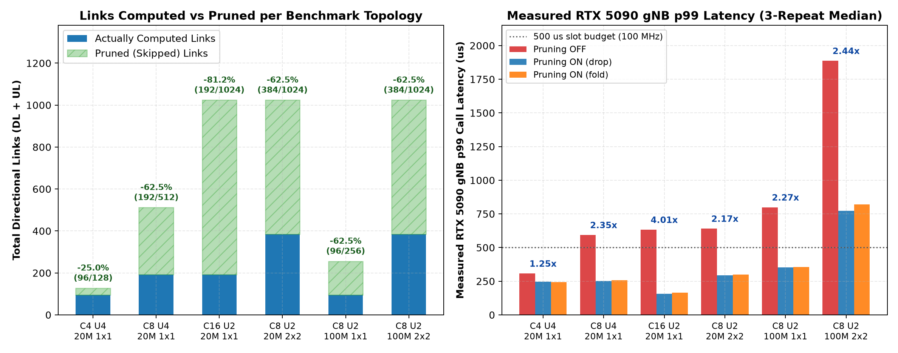
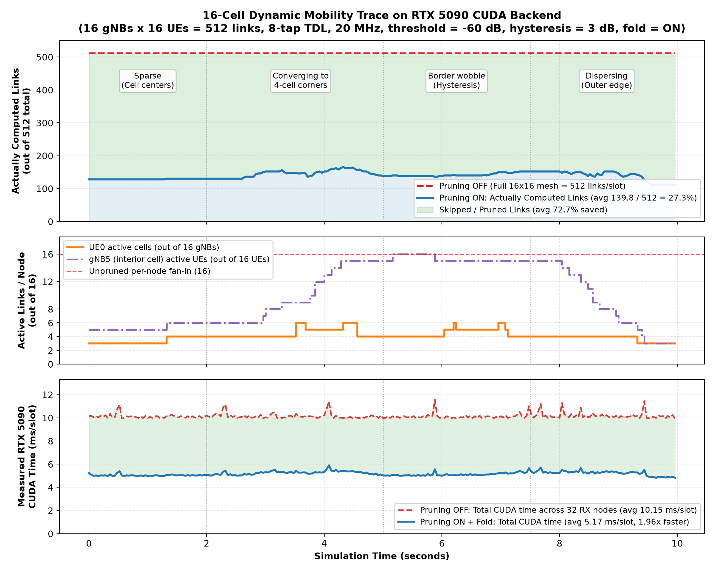

# Multi-cell interference pruning benchmark, 24 November 2026

Opt-in physical-link interference pruning (`runtime.prune_threshold_db`, `runtime.prune_hysteresis_db`, `runtime.prune_fold_to_awgn`) cuts multi-cell CUDA channel call latency by up to 4.0× (gNB) and 3.1× (UE) on an RTX 5090 by compacting inactive edges out of host packing, H2D transfer, and GPU kernels while keeping the unpruned default path bit-exact.

## Multi-cell CUDA scalability

Each entry reports the median of three 5-second runs (ascending, descending, ascending) after a separate 2-second warmup, for `gnb0` and `ue0` (`node:gnb0:call_us`, `node:ue0:call_us`), alongside the 3-run p99 range and CUDA event p99 times for `h2d_us` and `kernel_us`. Every cell connects to every UE with 8-tap TDL channels: serving cell at 6 dB path loss, two adjacent ring neighbors at 18 dB, and all remaining far cells at 85 dB, with `rx_model` AWGN (`noise_power: 1.0e-6`). Pruning uses `prune_threshold_db: -60.0` and `prune_hysteresis_db: 3.0`, keeping three active cells (serving + two neighbors) per UE and pruning all far edges.

| Topology (BW, MIMO) | Active / total edges per gNB (per UE) | Mode | gNB p50 (µs) | gNB p99 (µs) | gNB p99 range (µs) | gNB H2D / kern p99 (µs) | UE p50 (µs) | UE p99 (µs) | UE p99 range (µs) | UE H2D / kern p99 (µs) |
|---|---|---|---:|---:|---|---:|---:|---:|---|---:|
| `C4_U4` (20 MHz, 1×1) | 12 / 16 (3 / 4) | off | 258.5 | 307.2 | 305.4–308.1 | 75.9 / 27.9 | 98.4 | 113.8 | 113.6–113.9 | 30.8 / 14.7 |
| `C4_U4` (20 MHz, 1×1) | 12 / 16 (3 / 4) | on (drop) | 207.8 | 245.8 | 241.4–247.3 | 58.2 / 25.0 | 88.7 | 100.3 | 99.3–100.8 | 30.1 / 14.7 |
| `C4_U4` (20 MHz, 1×1) | 12 / 16 (3 / 4) | on (fold) | 209.8 | 244.1 | 243.9–245.9 | 58.4 / 25.0 | 89.0 | 100.4 | 100.1–100.7 | 30.1 / 14.7 |
| `C8_U4` (20 MHz, 1×1) | 12 / 32 (3 / 8) | off | 502.0 | 593.6 | 591.7–706.5 | 128.8 / 48.4 | 162.6 | 187.2 | 187.1–204.6 | 47.0 / 21.9 |
| `C8_U4` (20 MHz, 1×1) | 12 / 32 (3 / 8) | on (drop) | 217.7 | 252.7 | 251.8–259.6 | 59.3 / 25.0 | 90.4 | 102.6 | 102.1–104.0 | 30.2 / 14.8 |
| `C8_U4` (20 MHz, 1×1) | 12 / 32 (3 / 8) | on (fold) | 221.5 | 257.4 | 256.8–262.3 | 57.8 / 25.0 | 90.7 | 103.7 | 102.7–103.8 | 30.0 / 14.7 |
| `C16_U2` (20 MHz, 1×1) | 6 / 32 (3 / 16) | off | 496.5 | 632.4 | 614.9–655.7 | 150.2 / 48.6 | 272.4 | 329.0 | 327.7–337.8 | 82.8 / 32.1 |
| `C16_U2` (20 MHz, 1×1) | 6 / 32 (3 / 16) | on (drop) | 139.1 | 157.9 | 157.4–158.3 | 42.0 / 17.7 | 93.6 | 106.6 | 105.2–106.8 | 30.3 / 14.8 |
| `C16_U2` (20 MHz, 1×1) | 6 / 32 (3 / 16) | on (fold) | 137.1 | 163.9 | 163.6–165.7 | 38.9 / 18.8 | 95.4 | 109.3 | 109.2–113.0 | 29.7 / 14.8 |
| `C8_U2` (20 MHz, 2×2) | 12 / 32 (6 / 16) | off | 545.4 | 640.8 | 639.0–656.4 | 130.7 / 75.7 | 303.6 | 356.8 | 351.3–357.8 | 76.7 / 44.9 |
| `C8_U2` (20 MHz, 2×2) | 12 / 32 (6 / 16) | on (drop) | 246.2 | 295.2 | 295.1–297.4 | 60.8 / 38.0 | 153.3 | 178.7 | 176.4–180.0 | 37.2 / 26.2 |
| `C8_U2` (20 MHz, 2×2) | 12 / 32 (6 / 16) | on (fold) | 253.7 | 298.7 | 297.3–308.6 | 59.7 / 38.0 | 154.9 | 179.2 | 178.7–183.6 | 36.8 / 26.3 |
| `C8_U2` (100 MHz, 1×1) | 6 / 16 (3 / 8) | off | 655.5 | 798.8 | 797.0–818.4 | 167.2 / 50.9 | 368.7 | 446.3 | 438.8–450.8 | 98.9 / 32.2 |
| `C8_U2` (100 MHz, 1×1) | 6 / 16 (3 / 8) | on (drop) | 296.2 | 352.2 | 350.6–354.5 | 77.5 / 26.0 | 182.9 | 215.6 | 214.2–217.2 | 47.3 / 19.9 |
| `C8_U2` (100 MHz, 1×1) | 6 / 16 (3 / 8) | on (fold) | 297.9 | 356.8 | 351.7–358.6 | 72.7 / 26.0 | 183.5 | 215.7 | 215.6–221.2 | 47.3 / 19.9 |
| `C8_U2` (100 MHz, 2×2) | 12 / 32 (6 / 16) | off | 1443.6 | 1887.1 | 1839.5–1977.4 | 314.9 / 171.7 | 758.2 | 1042.1 | 1023.7–1049.9 | 176.5 / 92.2 |
| `C8_U2` (100 MHz, 2×2) | 12 / 32 (6 / 16) | on (drop) | 613.2 | 772.2 | 756.2–780.8 | 137.2 / 68.7 | 370.2 | 457.3 | 455.7–459.8 | 78.1 / 42.1 |
| `C8_U2` (100 MHz, 2×2) | 12 / 32 (6 / 16) | on (fold) | 628.9 | 821.6 | 813.8–825.4 | 134.9 / 68.7 | 376.3 | 475.4 | 474.8–476.9 | 78.8 / 42.1 |

Key observations:

- **Constant per-UE scaling ($O(K)$ vs $O(C)$)**: Across 4, 8, and 16 cells with three active cells per UE, unpruned `ue0` p99 grows linearly (`113.8 → 187.2 → 329.0 µs`), while pruned `ue0` p99 stays nearly flat (`100.3 → 102.6 → 106.6 µs`).
- **Peak speedup**: On `C16_U2` (20 MHz, 1×1), `gnb0` p99 improves **4.01×** (`632.4 → 157.9 µs`) and `ue0` p99 improves **3.09×** (`329.0 → 106.6 µs`).
- **100 MHz slot-budget recovery (500 µs slot at 30 kHz SCS)**: `C8_U2_100M_1x1` `gnb0` p99 drops from `798.8 µs` (above slot budget) to `352.2 µs` (within slot budget); `C8_U2_100M_2x2` `ue0` p99 drops from `1042.1 µs` to `457.3 µs`.
- **Folding overhead**: Enabling `prune_fold_to_awgn` adds sub-5 µs on 20 MHz workloads and 0–6% on 100 MHz p99, because subsampled TX power estimation reads 64 points per pruned source on the host without copying pruned IQ buffers to the GPU.

## Dynamic 16-cell mobility trace (active links over time)

To observe how the fraction of actually computed edges evolves as UEs move across cells, a 16-cell (4×4 grid, 500 m ISD) × 16-UE topology (512 directional 8-tap TDL edges, 20 MHz, 23,040 samples/slot, `prune_threshold_db: -60.0`, `prune_hysteresis_db: 3.0`, `prune_fold_to_awgn: true`) was stepped over 10 seconds (250 snapshots at 40 ms intervals) on the RTX 5090 CUDA backend via `BrokerLinkControl` path-loss updates (`PL(d) = 12 + 34 log10(max(d, 20)/20)` dB).

- **Unpruned (`off`)**: computes all 512 edges every slot; measured CUDA call sum across all 32 RX nodes averages **10.15 ms/slot**.
- **Pruned + fold (`on`)**: computes **112–166 edges** (average **139.8 / 512 = 27.3%**, average **72.7% pruned**) as UEs move from cell centers toward interior 4-cell junctions, oscillate near cell borders under 3 dB hysteresis, and disperse outward; measured CUDA call sum drops to an average of **5.17 ms/slot (1.96× faster)** and tracks the active-edge count directly.

Raw measurements are stored alongside this report in `formal_multicell_results.csv` and `timeseries_16cell.csv`.

## Aggregate interference accuracy (`drop` vs `fold`)

To measure power bias when many weak cells are pruned together, 16 uncorrelated interfering cells (distinct CFO per cell) and one serving cell (`path_loss_db: 10.0`) arrive at a single UE with `rx_model` AWGN (`noise_power: 1.0e-4`) and `prune_threshold_db: -25.0`. Reference received power is measured with pruning disabled.

| Weak cell path loss (dB) | Reference RX power (dB) | Drop-only bias (dB) | Fold-to-AWGN bias (dB) |
|---:|---:|---:|---:|
| 30.0 | −9.35 | −0.5887 | +0.0607 |
| 40.0 | −9.93 | −0.0695 | +0.0000 |
| 50.0 | −9.99 | +0.0000 | +0.0000 |
| 60.0 | −10.00 | +0.0000 | +0.0000 |

`prune_fold_to_awgn` assumes pruned interferers are mutually uncorrelated and approximates their aggregate contribution as additive white Gaussian noise ($\sum_i P_{\text{tx},i} G_{\text{eff},i}$). Strongly coherent or structured interferers do not combine linearly in power, and folded AWGN does not preserve waveform phase or burst structure; configure `prune_threshold_db` below any interferer whose waveform structure matters to the receiver.

## Live two-cell OCUDU gNB + srsUE interop

Two containerized OCUDU gNBs (`PCI=1`, `PCI=2`, 20 MHz FDD band n3, 23.04 MS/s, 1×1), two srsUE containers (`10.45.1.2`, `10.45.1.3`), and Open5GS 5GC ran through the native CUDA broker for 40 seconds per mode (`serving` 6 dB path loss, `intercell` 80 dB path loss, pruning at `prune_threshold_db: -60.0` / `prune_hysteresis_db: 3.0`, cutting active edges from 2 to 1 per RX node).

| Mode | Cells up / RF overflow | UE0 & UE1 attach / PDU | Ping (5× ICMP, both UEs) | Broker `tx_queue_overflows` / `tx_sequence_gaps` / `zmq_errors` | `rx_starvations` | Broker `call_us` p50 (`gnb0`/`gnb1`/`ue0`/`ue1`) | Broker `call_us` p99 (`gnb0`/`gnb1`/`ue0`/`ue1`) |
|---|---|---|---|---|---:|---|---|
| off | 2/2, 0 ovf | 2/2 RRC + PDU | 100% (26.7 / 27.6 ms) | 0 / 0 / 0 | 2 | 105 / 105 / 105 / 105 µs | 155 / 160 / 190 / 190 µs |
| on (drop) | 2/2, 0 ovf | 2/2 RRC + PDU | 100% (29.0 / 27.7 ms) | 0 / 0 / 0 | 2 | 85 / 85 / 85 / 85 µs | 125 / 145 / 170 / 170 µs |
| on (fold) | 2/2, 0 ovf | 2/2 RRC + PDU | 100% (26.9 / 27.1 ms) | 0 / 0 / 0 | 6 | 80 / 80 / 80 / 80 µs | 115 / 145 / 155 / 140 µs |

In all three modes both UEs attached to their own cells, established PDU sessions, and passed ICMP traffic with zero transport errors or gNB RF overflows, while per-node broker p50 channel latency dropped 19–24% even at two cells. The startup `rx_starvations` (2–6) match historical static Docker runs; strict zero-starvation real-time qualification is not claimed.

## Setup, limits, and reproduction

- **Hardware and toolchain**: NVIDIA GeForce RTX 5090 (PCIe Gen 5 ×16 max, driver 595.71.05), Intel Core Ultra 9 285K, CUDA 13.0 (`V13.0.88`), GCC 13.3.0, Release `sm_120` build, explicit CUDA copies (`cuda_zero_copy=0`), based on `upstream/main` (`c3135a901e92fac30926b773cb590fb2fe649782`).
- **Benchmark harness**: `OCG_BENCH_PACE=0 OCG_BENCH_REFRESH=0 OCG_BENCH_THREADS=0 ocudu-gpu-channel-bench --config <topo.yaml> --duration 5s --scs-khz <15|30> --per-node`. 20 MHz runs use 23,040 samples/call (1 ms at 15 kHz SCS); 100 MHz runs use 61,440 samples/call (0.5 ms at 30 kHz SCS).
- **Correctness and memory checks**: CPU and CUDA CTest suites pass 14/14 each (including `interference_pruning` covering config validation, static/negative-control pruning, 2×2 MIMO CPU/CUDA parity, dynamic `path_loss_db` and `profile_swap` hysteresis/reactivation parity, and 16-cell residual AWGN folding); `compute-sanitizer --error-exitcode=1` on `test_interference_pruning` reports zero errors.
- **Scope limits**: Pruning is strictly opt-in (`prune_threshold_db` unset preserves the unpruned path). Broker-level `wait_data` synchronization is intentionally unchanged so all cells remain locked to the same virtual sample clock for TDD frame alignment and handover safety. Timing results do not transfer to other GPUs, sample rates, or live multi-cell stacks without re-measurement.
